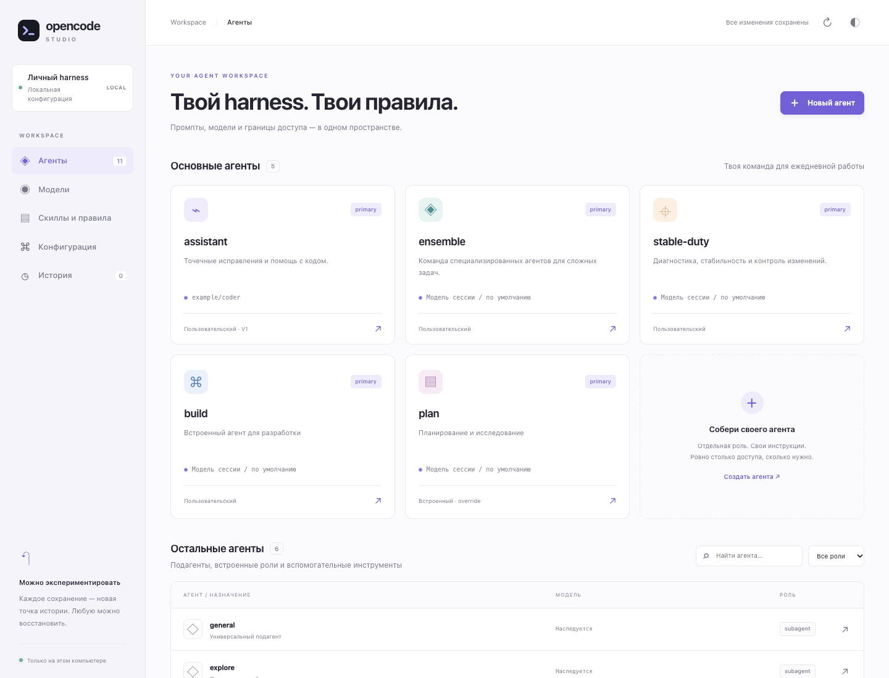
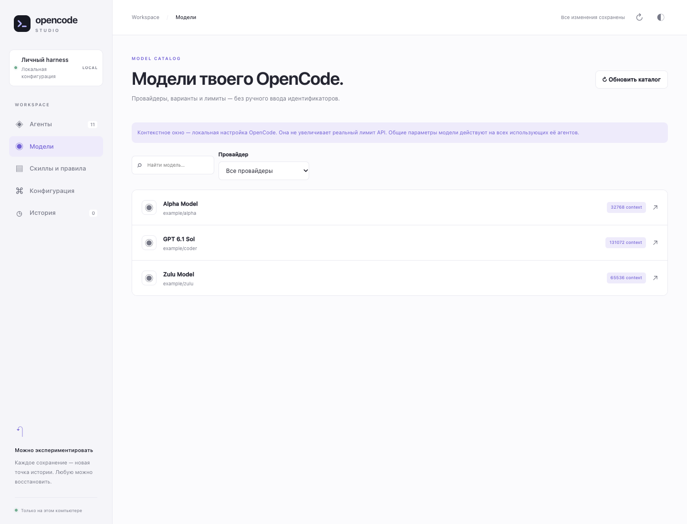
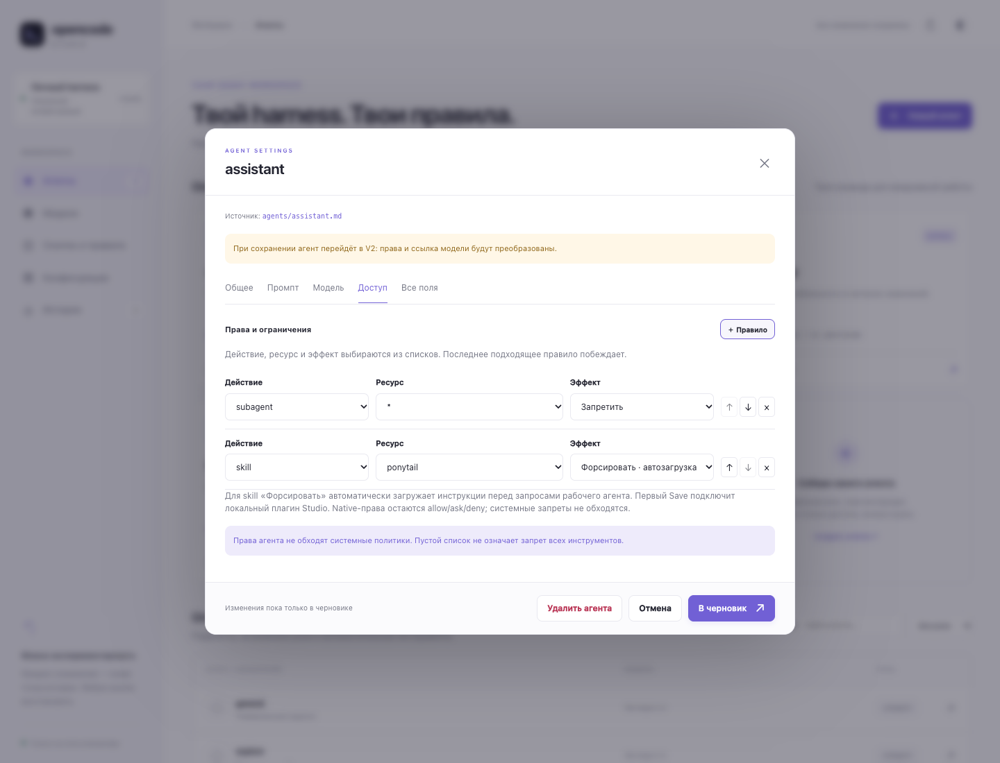
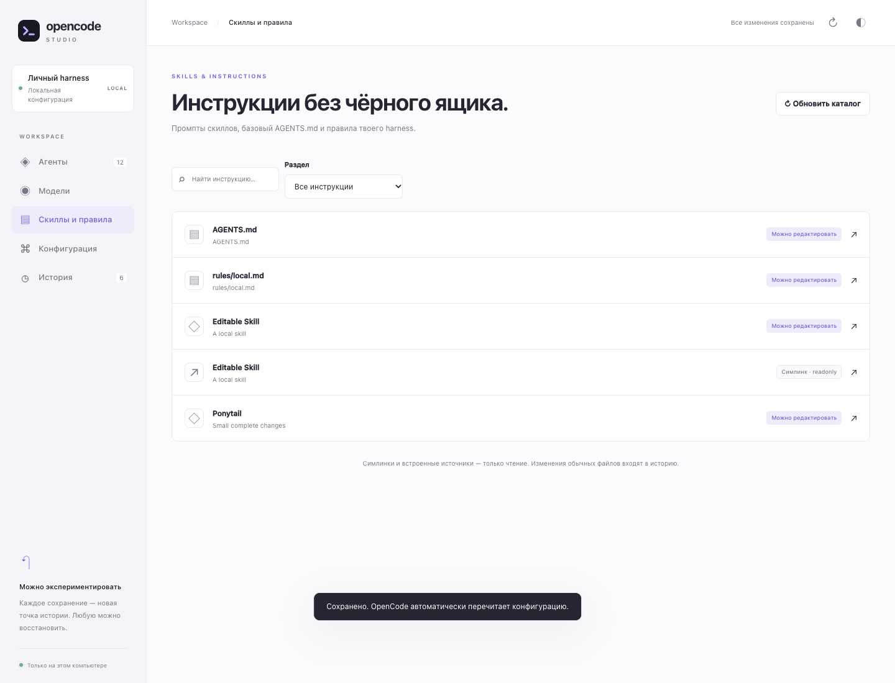

<div align="center">

# OpenCode Studio

### Твой harness. Твои правила.

Агенты, модели, скиллы и инструкции OpenCode — в одном локальном интерфейсе.<br>
С черновиками, историей изменений и возможностью вернуться назад.


**На 100% навайбкожено шикарным и великим GPT 6.1 Sol**

[Быстрый старт](#быстрый-старт) · [Возможности](#возможности) · [Форсирование скиллов](#форсирование-скиллов) · [Безопасность](#безопасность-и-границы)

<picture>
  <source media="(prefers-color-scheme: dark)" srcset="docs/screenshots/overview-dark.png">
  
</picture>

</div>

> Самостоятельный локальный инструмент для **глобальных настроек OpenCode**. Не чат-клиент и не официальный продукт OpenCode. Без облачного сервиса, базы данных, телеметрии и сборщика фронтенда. Скриншоты используют только синтетические данные.

## Быстрый старт

Нужны **Node.js 22+**, npm и установленный [OpenCode V2](https://opencode.ai/v2/docs/cli), доступный командой `opencode`.

В каталоге проекта:

```sh
npm ci
npm start
```

Браузер откроется автоматически. Обычный адрес — **http://127.0.0.1:4317**; если порт занят, Studio выберет свободный и напечатает его в терминале. Остановка — `Ctrl+C`.

Для запуска одной командой из любого каталога:

```sh
npm link
opencode-studio
```

**Никакие настройки OpenCode не записываются до нажатия «Сохранить».** Локальное хранилище истории и его ключ создаются при запуске, а снимки — при первом сохранении.

## Возможности

| Раздел | Что можно сделать |
| --- | --- |
| **Агенты** | Создать свою роль или подагента с нуля либо кнопкой «Копировать» в редакторе другого агента. Настроить промпт, режим, видимость и цвет. Найти остальные роли через поиск. Удалить своего агента или отключить встроенного, включая `build` и `plan`. |
| **Модели** | Выбрать модель и вариант из каталога OpenCode. Отдельно настроить лимиты контекста, входа и выхода. Списки отсортированы по алфавиту. |
| **Доступ** | Собрать упорядоченные правила `allow` / `ask` / `deny` из списков действий и ресурсов. Для конкретного скилла — включить автозагрузку через «Форсировать». |
| **Скиллы и правила** | Читать скиллы, глобальный `AGENTS.md` и rules. Редактировать обычные файлы и тело скилла без переписывания frontmatter. Симлинки и защищённые источники — только для чтения. |
| **Конфигурация** | Открыть JSON/JSONC и дополнительные поля агента, настроить providers, MCP, plugins и CLI. Незнакомые параметры не выбрасываются из полного JSON-редактора. |
| **История** | Сохранить именованную точку, посмотреть затронутые файлы и восстановить состояние. Откат создаёт новое событие и не стирает последующую историю. |

Светлая и тёмная темы, адаптивная вёрстка, черновики без автоматической записи.

<details>
<summary><strong>Посмотреть модели, права и редактор инструкций</strong></summary>

### Модели


### Права и обязательный скилл


### Скиллы и правила


</details>

## Как работать

1. Открой агента, модель или документ и измени нужные поля.
2. Отправь изменения **в черновик**. Закрытие редактора без этого шага отменяет его несохранённые правки.
3. Нажми **«Сохранить»**, дай изменению название — Studio запишет файлы и снимок истории.
4. Для отмены открой **«Историю»**, проверь список затронутых путей и восстанови точку.

`Cmd/Ctrl+S` в редакторе отправляет изменения в черновик; вне редактора открывает сохранение. Черновики живут только в памяти страницы: перезагрузка их сбросит. В `localStorage` хранится только тема.

Если файлы изменились снаружи, устаревший черновик не сможет их перезаписать. Внешнее состояние записывается отдельной контрольной точкой перед следующим успешным сохранением или откатом.

## Форсирование скиллов

Например: **агент → Доступ → новое правило → `skill` → `ponytail` → «Форсировать · автозагрузка» → в черновик → Сохранить**.

Это **расширение Studio**, а не новый нативный эффект permissions:

- В правах OpenCode сохраняется обычный `allow`. Намерение «форсировать» хранится отдельно в настройках плагина.
- Первое сохранение такого правила подключает локальный плагин `opencode-studio.required-skills` из `local-plugins/studio-required-skills` внутри каталога конфигурации.
- Перед каждым основным запросом к модели в цикле настроенного агента плагин читает актуальное содержимое скилла и добавляет его в системный контекст. Повторный вызов инструмента `skill` для чтения не нужен.
- Нативная проверка доступа остаётся обязательной. Плагин не обходит permissions или policies, не запускает вспомогательные инструменты и не выдаёт им права.
- Правила применяются по порядку: **последнее подходящее побеждает**. Более поздний `deny` или `ask` может сделать форсирование неактивным. Wildcard для «Форсировать» недоступен.
- Поддерживаются рабочие агенты и подагенты; служебные `title`, `summary` и `compaction` исключены.
- Удаление последнего force-правила убирает управляемый плагин. Его настройки и исходник входят в историю. Если native-права поменялись снаружи, Studio требует явного сброса старого форсирования.

**Загрузка инструкций не гарантирует, что модель исполнит их безошибочно.** Более приоритетные инструкции и системные ограничения сохраняют силу.

Проверена активация плагина установленным OpenCode **2.2.1** на изолированном сервере. Добавление контекста, обновление содержимого и запрет доступа проверены тестами hook API; сквозной запрос к настоящей модели не выполнялся.

## Безопасность и границы

- Сервер слушает только `127.0.0.1`. Host/Origin-проверки, обязательный заголовок для записи, CSP и запрет фреймов защищают от межсайтовых браузерных запросов. **Не публикуй сервер через proxy или tunnel:** удалённой аутентификации у Studio нет.
- Снимки зашифрованы **AES-256-GCM**, каталог истории имеет права `0700`, локальный ключ — `0600`. Ключ и история вместе чувствительны; потеря ключа означает потерю доступа к снимкам. Это не резервная копия от поломки диска и не защита от программ, работающих от твоего пользователя.
- Поля, похожие на credentials, маскируются в JSON-интерфейсе и сохраняются сервером без подстановки маски вместо секрета. Каталог моделей отдаёт только выбранные метаданные, не ключи и headers. Произвольный секрет в промпте, комментарии, URL или поле с нестандартным именем может не распознаться — используй env/file references вместо inline-секретов.
- Симлинки, их дочерние файлы и защищённые источники readonly. Редактируемые внешние **тела скиллов** входят в историю, но их вспомогательные каталоги и assets — нет. Если отслеживаемый внешний файл стал симлинком, восстановление блокируется.
- Откат глобального каталога удаляет файлы, добавленные после выбранной точки. Сначала проверь предпросмотр. Журнал восстанавливает прерванную многофайловую операцию при следующем запуске; watcher OpenCode может увидеть промежуточные состояния во время записи.
- Studio не объединяет все project/system overrides и provider-dependent defaults в редактируемые настройки. Это редактор глобального слоя, а не окончательного effective config текущей сессии.

## Технические подробности

<details>
<summary><strong>Запуск, совместимость, история и ограничения</strong></summary>

## Start

```sh
npm install
npm start
```

This starts a loopback-only server and opens the browser. The terminal prints the local URL. Press Ctrl+C to stop. The default port is 4317; if occupied, an available port is chosen.

Optional terminal command:

```sh
npm link
opencode-studio
```

Flags:

```sh
opencode-studio --no-open
opencode-studio --port 4321
opencode-studio --config ./test-config --history ./test-history
```

`--config` must be an existing directory. A separate history belongs to exactly one configuration directory. `XDG_CONFIG_HOME` and `XDG_STATE_HOME` are respected. The UI edits global configuration, not project settings or the current session's model.

## Editing

- Main cards include every visible primary/all agent, including custom agents. assistant, ensemble, stable-duty, build and plan appear first when applicable; subagents and hidden agents remain in the searchable catalog.
- A searchable catalog for all other configured agents and V2 built-in/hidden agents.
- Agent prompt, mode and visibility. Color is selected from a named palette; model and variant are selected from the current OpenCode runtime catalog. Unavailable existing selections are labelled, not silently replaced.
- Ordered access-rule pickers for actions, resources and allow/ask/deny, with add/remove/reorder controls. Existing action/resource patterns and global permission patterns remain selectable. An advanced JSON editor is still available for uncommon agent fields.
- Step limits are removed from the UI and from an agent when it is saved.
- Create a new Markdown agent, including nested IDs such as `team/writer`.
- Delete custom agents/subagents or built-ins, including build and plan. Custom definitions are removed; built-ins receive native `disabled: true` overrides. The default agent is adjusted if necessary. Deletions enter the draft, require Save and can be restored through history.
- A separate **Models** menu shows the OpenCode catalog with provider/model selection, context/input/output limit pickers, tools support, availability and supported reasoning effort values. The context presets configure OpenCode, not the upstream service's real capacity. The model's other fields are preserved. These settings affect all consumers of that model.
- A **Skills & rules** menu shows registered skills, the global AGENTS.md and rules. Skill bodies can be tuned without rewriting frontmatter. Symlinks (including any symlink parent), built-in/runtime-only sources and files in the main Arcadia checkout are readonly. Ordinary global/external skills are editable and covered by history. Before the runtime catalog loads, local source discovery is used.
- JSON configuration editor for all root settings (providers, MCP, plugins, skills, policies, etc.), CLI settings, and text editors for local instructions/rules/commands.
- Edits first enter a draft. Only **Save** writes files. Cmd/Ctrl+S moves an open editor into the draft; outside the editor it opens Save.
- Closing/cancelling an editor discards its unsubmitted edits. Drafts are held in browser memory, not persisted in localStorage. Only theme preference is persisted there.

Saving an agent converts that agent to V2, including permissions, disabled state and model variants. Unsupported legacy sampling/options fields are listed in the editor and removed; select a supported model variant instead. Step limits are removed. Saving model settings converts the selected provider and its models to V2 while preserving credentials, other models and unrelated configuration. This is not a bulk migration of every untouched config section. JSONC edits preserve unrelated sections/comments; editing a section may reformat it. Markdown frontmatter uses YAML document editing to preserve untouched comments.

Built-in cards without a user definition represent a user override. Their prompt tab can optionally read the current static system prompt through the installed `opencode api` CLI, then explicitly copy it into the editor. Catalog reads may start OpenCode's background service. Runtime inspection uses the Studio directory as its location; inherited system/ancestor settings can affect the result. A provider-dependent base prompt may not exist in Agent.Info until a model request is constructed. External `{file:…}` references are not expanded. Symlinked skills/rules may be read for preview but never edited through the link. Project/system settings, global permission rules, plugin-defined agents, and provider-dependent defaults are not resolved into the editable configuration.

The catalog explicitly projects picker metadata; provider settings, credentials and request headers are never sent in a model catalog response. Raw CLI responses may contain credentials. They are read through private temporary files to avoid a truncation bug in the installed CLI, then deleted; raw parse errors are never returned or logged.

Validation covers JSON/YAML syntax and common agent fields. It is not the complete OpenCode/provider/plugin schema. The full JSON editor intentionally preserves unknown settings.

## Storyline and rollback

History is stored outside the configuration under `$XDG_STATE_HOME/opencode-studio/<directory-hash>` (default `~/.local/state`). The directory/key are initialized at startup; the first snapshots are created only on Save:

1. Capture the original configuration.
2. Capture each saved configuration, its title, time, parent, and changed paths.
3. Before restoring, preview all affected paths.
4. A restore is a new event; later snapshots are not deleted.

External changes are checked using a fingerprint of the whole managed tree. A stale draft cannot overwrite them. Before the next successful save/restore, external changes are also recorded as a checkpoint. There is no background watcher recording every filesystem edit. A journal recovers an interrupted multi-file operation on the next startup; a live OpenCode watcher may observe intermediate files during a multi-file restore.

The snapshot covers the global directory: configuration, agents, rules, commands, skills, plugin sources, package manifests/locks, file permissions, directories and symlink identities. Snapshot traversal never follows symlinks. Editable external skill prompt files discovered from global compatibility/configured sources are also tracked, fingerprinted, encrypted and restored. This does not include their supporting directories/assets. If a tracked external file becomes a symlink or enters a protected source, restoring it is blocked. Older checkpoints that did not track an external file leave that file alone rather than deleting it. Global-directory files added since a snapshot are removed on restore.

Excluded: `node_modules`, `.git`, `.DS_Store`, `.cache`, `cache`, `logs`, `dist`, `auth.json`, `service.json`, notifier runtime state, the bundled `bin/openkode-runtime` executable, `.env*`, and `*.pem`, `*.key`, `*.p12` files. OpenCode sessions/authentication databases and other external files are not included. Configuration files referencing excluded/external credentials are restored, but those credential stores are not. Limits: 4 MiB per managed file, 32 MiB total; exceeding these fails explicitly rather than saving a partial snapshot. External plugin sources and skill supporting assets are outside rollback scope; only ordinary editable skill prompt files are enrolled.

Snapshots (including inline credentials, when present in config) are AES-256-GCM encrypted with a local 0600 key in a 0700 history directory. Inline credentials in JSON settings are masked in the UI and kept server-side when a masked field is saved. Env/file references are kept as references. This masking recognizes credential-shaped field names, not arbitrary secret text in prompts, comments, custom-named fields or URLs. Avoid inline secrets; use env/file references. Suspicious credential assignments in instruction files disable their text editor.

This is local privacy protection, not protection against other software running as your user. There is no remote authentication: keep the server loopback-only and do not expose it through a proxy/tunnel. Host/Origin checks, a required custom JSON request header, CSP and frame restrictions block browser cross-site writes and DNS rebinding. The encryption key and snapshots together are sensitive: do not publish them. Losing the key loses access to history. This is **not a backup against disk loss**.

## Verification

```sh
npm test
npx playwright install chromium
npm run test:ui
# Or use an already installed Google Chrome, with a temporary isolated profile:
STUDIO_BROWSER_CHANNEL=chrome npm run test:ui
# Installed OpenCode V2; dedicated test server, no model requests:
npm run test:plugin
```

Tests use temporary synthetic configurations and isolated compatibility roots under ignored `test-results/`, never the live global configuration. Browser checks exercise pickers, V2 migration, creation/deletion, model context settings, readonly/ordinary skills, masked JSON editing, save, full restore, validation, themes and mobile layout. Screenshots are also synthetic and saved under `test-results/`.

</details>

---

<div align="center">

**Меньше ручного JSON. Больше контроля над своей командой агентов.**

Node.js · ESM · Browser JavaScript · CSS<br>
Сделано с вайбом. Проверяется тестами.

</div>
